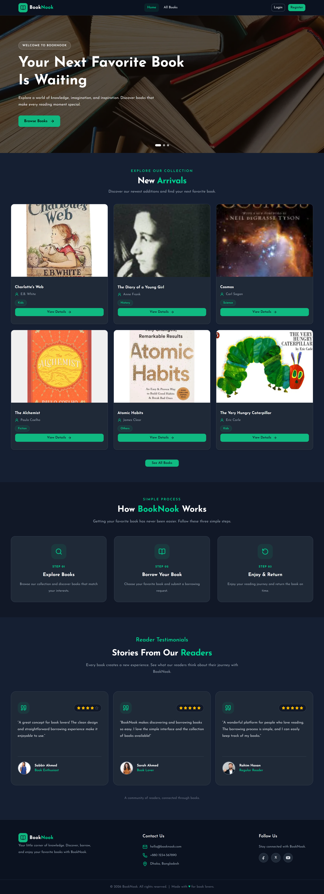
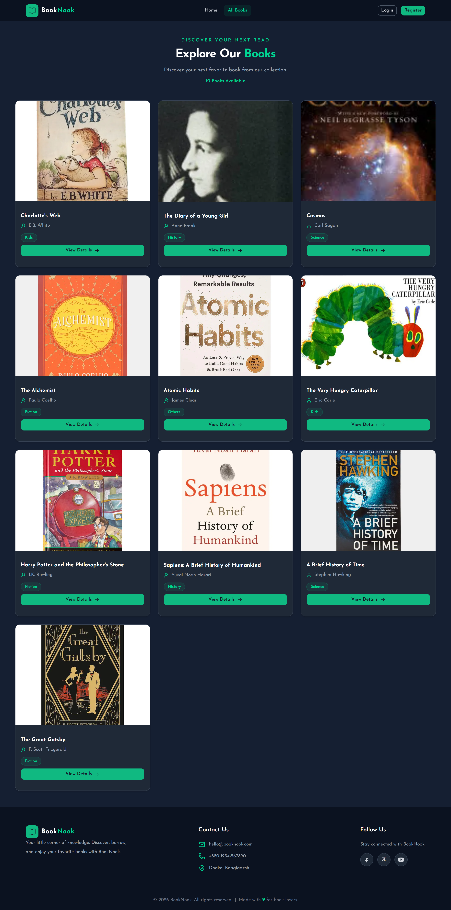
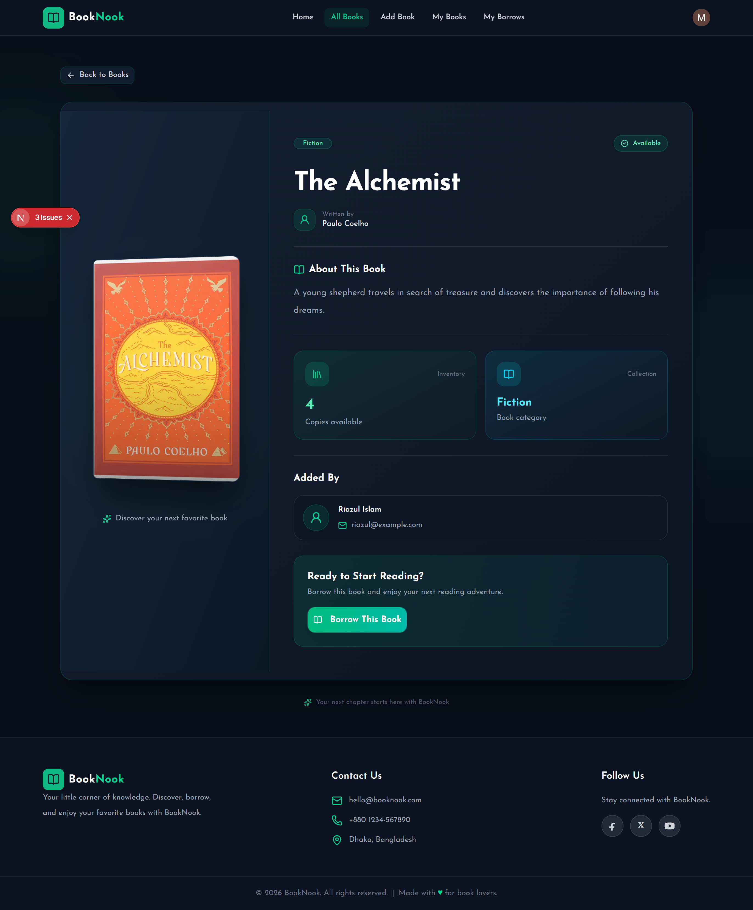
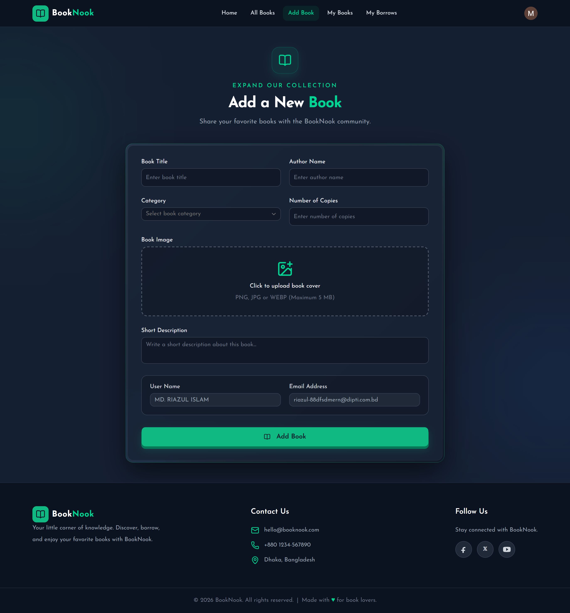
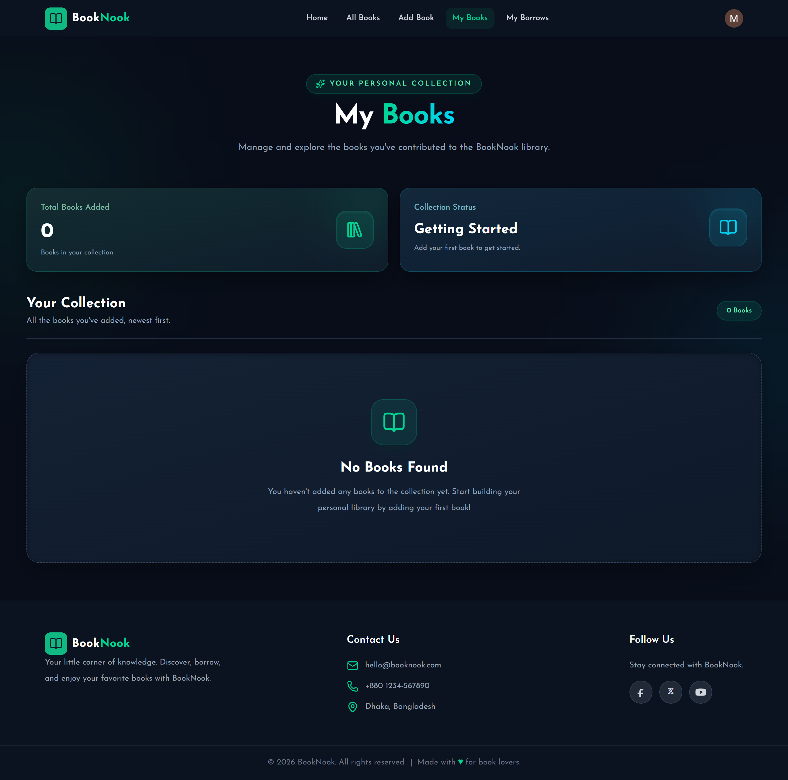
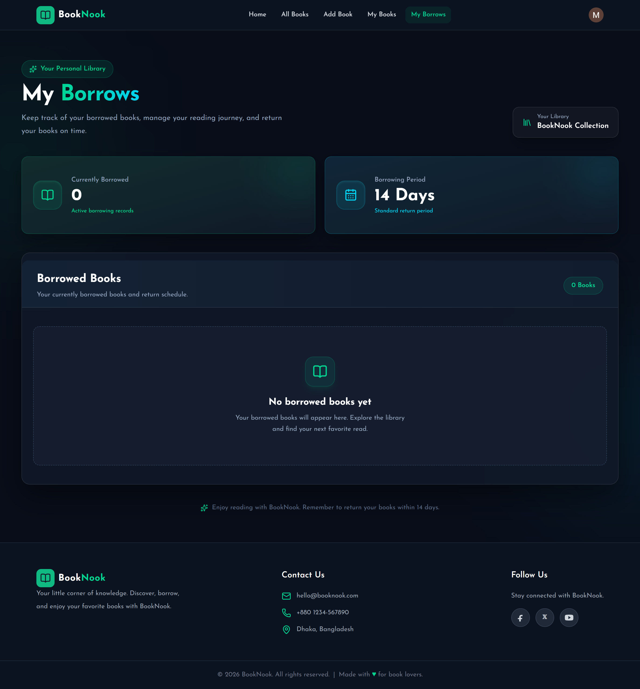
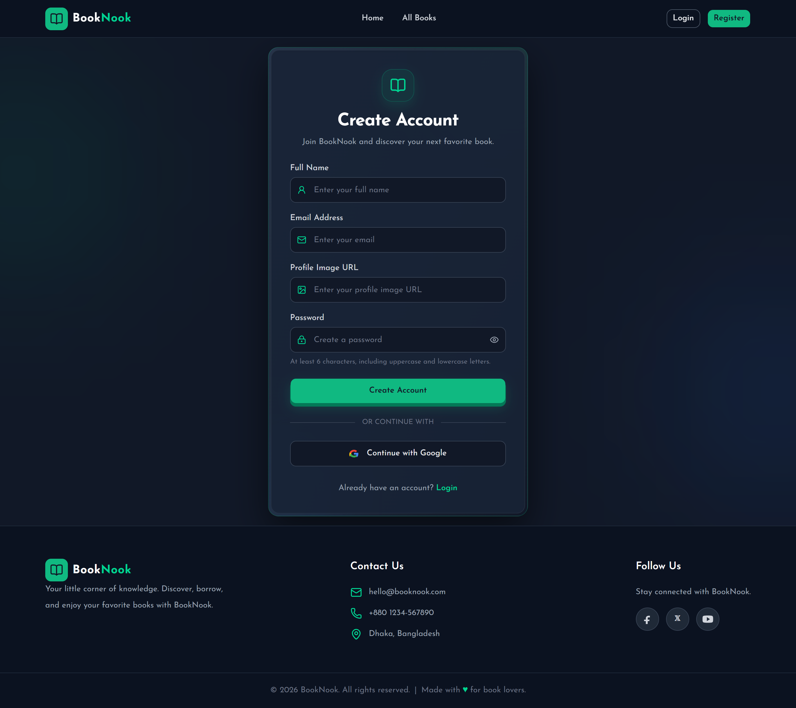

# 📚 BookNook — Online Library Management System

<p align="center">
  **Discover. Borrow. Read. Return.**
</p>

<p align="center">
  A modern online library management platform where readers can explore books, borrow their favorites, and manage their reading journey.
</p>

<p align="center">
  <a href="https://library-booknook.vercel.app">🌐 Live Demo</a> •
  <a href="https://github.com/Riaz-RZ/booknook">📂 GitHub Repository</a>
</p>

---

## 📖 About the Project

**BookNook** is a full-stack library management application designed to make book discovery and borrowing simple and convenient.

Users can explore a collection of books, view detailed information, borrow available copies, and manage their borrowed books. The platform also allows authenticated users to add and manage their own book listings.

The application features a responsive interface, secure authentication, and an inventory-based borrowing system that keeps book availability updated automatically.

## ✨ Key Features

### 📚 Book Management
- Explore all available books in the library.
- View detailed information about individual books.
- Add new books with title, author, category, description, image, and copy quantity.
- Manage and delete books added by the logged-in user.
- Browse books by category.

### 🔄 Borrowing & Returning System
- Borrow books directly from the book details page.
- Automatically decrease available copies when a book is borrowed.
- Prevent borrowing when no copies are available.
- Prevent a user from borrowing the same book more than once at a time.
- Automatically increase available copies when a book is returned.
- Set an expected return date for borrowed books.
- Track all borrowed books from the personal borrowing page.

### 🔐 Authentication
- Secure user registration and login.
- Google authentication.
- Better Auth integration.
- Protected user-specific pages and actions.

### 🎨 User Interface
- Modern and responsive design.
- Dark and light theme support.
- Interactive book cards and carousels.
- Loading skeletons and loading indicators.
- Custom 404 page.
- Toast notifications for user feedback.
- Smooth animations and interactive components.

## 🛠️ Technologies Used

### Frontend
- Next.js
- React
- TypeScript
- Tailwind CSS
- Shadcn UI
- Lucide React
- Swiper.js
- Sonner

### Backend & Database
- Node.js
- Express.js
- MongoDB
- Better Auth
- JWT Authentication

### Tools & Services
- Git & GitHub
- Vercel
- ImgBB (Image Hosting)

## 🚀 Getting Started

Follow these instructions to run the project locally.

### Prerequisites

Make sure you have installed:

- Node.js (LTS recommended)
- npm
- MongoDB database
- Git

### 1. Clone the Repository

```bash
git clone https://github.com/Riaz-RZ/booknook.git
```

### 2. Navigate to the Project Directory

```bash
cd booknook
```

### 3. Install Dependencies

```bash
npm install
```

### 4. Configure Environment Variables

Create a `.env.local` file in the project root directory and configure the required environment variables.

```env
NEXT_PUBLIC_API_URL=your_backend_api_url
BETTER_AUTH_URL=http://localhost:3000
```

Configure your backend environment variables separately, including your MongoDB connection string, authentication secrets, Google OAuth credentials, and ImgBB API key.

**Important:** Never commit your actual environment variables or secret keys to GitHub.

### 5. Run the Development Server

```bash
npm run dev
```

Open [http://localhost:3000](http://localhost:3000) in your browser.

## 📁 Project Structure

```text
booknook/
├── public/
├── src/
│   ├── app/
│   │   ├── all-books/
│   │   ├── add-book/
│   │   ├── book/
│   │   ├── login/
│   │   ├── register/
│   │   ├── my-books/
│   │   ├── my-borrows/
│   │   ├── layout.tsx
│   │   └── page.tsx
│   ├── components/
│   │   ├── auth/
│   │   ├── books/
│   │   ├── shared/
│   │   └── ui/
│   └── lib/
├── .env.local
├── package.json
└── README.md
```

*Note: This is a simplified overview of the frontend structure.*

## ⚙️ Core Borrowing Logic

BookNook uses an inventory-based borrowing system to maintain accurate book availability.

1. A book is added with an initial number of available copies.
2. When a user borrows a book, the available copy count decreases by one.
3. A book cannot be borrowed when its available copy count reaches zero.
4. A user cannot borrow the same book again while their previous borrowing record is active.
5. When a book is returned, its available copy count increases by one and the active borrowing record is removed.

This helps maintain accurate inventory and prevents invalid borrowing operations.

## 🌐 Live Application

**Live Website:** https://library-booknook.vercel.app

**GitHub Repository:** https://github.com/Riaz-RZ/booknook

## 🔗 Project Repositories

BookNook is built with separate frontend and backend repositories.

| Part | Repository | Technologies |
|---|---|---|
| Frontend | [booknook](https://github.com/Riaz-RZ/booknook) | Next.js, React, TypeScript, Tailwind CSS |
| Backend | [booknook-server](https://github.com/Riaz-RZ/booknook-server) | Node.js, Express.js, MongoDB |

### 🌐 Live Links

- **Live Application:** https://library-booknook.vercel.app
- **Frontend Repository:** https://github.com/Riaz-RZ/booknook
- **Backend Repository:** https://github.com/Riaz-RZ/booknook-server

## 📸 Screenshots











## 🎯 Project Goals

The main goal of BookNook is to build a practical library management system while applying modern full-stack development concepts, including:

- Authentication and authorization.
- REST API integration.
- Database operations with MongoDB.
- CRUD operations.
- Inventory management.
- Responsive UI development.
- Full-stack application deployment.

## 👨‍💻 Developer

**Riazul Islam**

Full Stack Developer in Learning | Building Modern Web Applications

- GitHub: [@Riaz-RZ](https://github.com/Riaz-RZ)
- LinkedIn: [Riazul Islam](https://www.linkedin.com/in/riazul-islam89)

---

<p align="center">
  Made with ❤️ for book lovers.
</p>